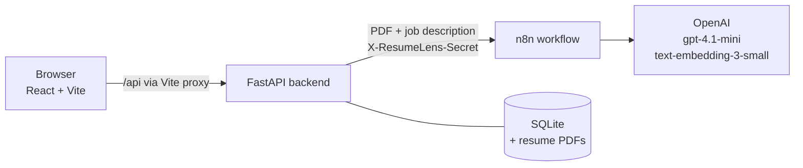

# ResumeLens

**Evidence-grounded resume analysis against a specific job description.**

[](https://www.python.org/)
[](https://fastapi.tiangolo.com/)
[](https://react.dev/)
[](https://n8n.io/)
[](LICENSE)

ResumeLens scores how well a resume matches a job description and shows *why*. Most ATS
checkers count keywords. ResumeLens splits the job description into individual requirements,
looks for concrete evidence of each one in the resume, and scores the result with a fixed,
transparent formula. Every verdict links back to the resume lines that support it.

---

## Contents

- [Features](#features)
- [How it works](#how-it-works)
- [Scoring model](#scoring-model)
- [Tech stack](#tech-stack)
- [Getting started](#getting-started)
- [Configuration](#configuration)
- [Testing](#testing)
- [Project structure](#project-structure)
- [Security and privacy](#security-and-privacy)
- [Limitations](#limitations)
- [License](#license)

---

## Features

- **Requirement-level matching.** Each skill, responsibility, education requirement and soft
  skill in the job description is evaluated on its own, with a decision, a confidence score
  and a short explanation.
- **Evidence you can check.** Every positive decision cites the exact resume lines it is based
  on (project bullets, skills, certifications), shown under each requirement.
- **Semantic matching.** Embeddings and an LLM judge recognize transferable experience (for
  example, a RAG project counting towards "build retrieval pipelines") instead of exact
  keyword matches only.
- **Deterministic score.** The LLM classifies requirements; the score itself comes from fixed
  weights in code, so the same evaluations always produce the same number.
- **Degree-aware education matching.** Recognizes common degrees and levels (B.Tech, B.E.,
  B.Sc, BCA, M.Tech, MCA, MBA, PhD, "Bachelor's", "Master's"), treats a higher degree as
  meeting a lower requirement, and handles "B.Tech, M.Tech or MCA" style alternatives.
- **Actionable summary.** Top strengths, highest-impact gaps, skill status (matched / needs
  evidence / missing) and three prioritized actions.
- **Accounts and history.** Email and password accounts. Every analysis is saved with its
  resume PDF and job description, can be reopened, re-downloaded or deleted, and feeds a
  score-over-time chart.

---

## How it works



The browser only talks to the local FastAPI backend. The backend checks the user's session,
calls the n8n workflow with a shared secret, saves the result, and returns it. The webhook
URL never appears in frontend code.

The n8n workflow runs this pipeline for each analysis:

1. **Parse.** The resume PDF is converted to text and parsed into structured JSON (education,
   experience, projects, skills, certifications, activities). The job description is parsed
   into requirements tagged as *required* or *preferred*.
2. **Build evidence.** Every resume fact becomes an evidence item with an ID, and every job
   requirement becomes a requirement item with an ID.
3. **Exact match.** Technical skills that appear verbatim in the resume are matched directly.
4. **Retrieve.** Remaining requirements and all evidence are embedded, and the three most
   similar evidence items are retrieved for each requirement by cosine similarity.
5. **Judge.** An LLM evaluates each requirement against its retrieved evidence and returns a
   decision, a confidence and a comment. It may only cite evidence IDs it was given.
6. **Score.** Decisions are converted into category and overall scores with fixed weights (see
   below). Education is matched by rule, not by the LLM.
7. **Summarize.** A second LLM call turns the scored evaluation into a short verdict,
   strengths, gaps and actions, using only the evidence provided.

---

## Scoring model

Each requirement receives one decision:

| Decision | Meaning | Points |
|---|---|---|
| `EXACT` | The resume directly demonstrates the requirement | 1.00 |
| `STRONG_MATCH` | The underlying capability is clearly shown, in different words or context | 0.85 |
| `PARTIAL` | Related capability is shown, but important parts are missing | 0.50 |
| `NO_MATCH` | The evidence is unrelated | 0.00 |
| `INSUFFICIENT_EVIDENCE` | Not enough evidence to judge | 0.00 |
| `NOT_APPLICABLE` | Excluded from scoring (for example, an unmet alternative degree) | — |

Points are weighted by priority (required = 1.0, preferred = 0.5) and averaged within each
category. The overall score is a weighted mean of the categories:

| Category | Weight |
|---|---|
| Technical skills | 40% |
| Responsibilities | 40% |
| Education | 10% |
| Soft skills | 10% |

A category the job description does not mention is left out, and the remaining weights are
rescaled, so candidates are not penalized for requirements that do not exist.

---

## Tech stack

| Layer | Technology |
|---|---|
| Frontend | React 19, Vite, React Router, plain CSS with design tokens |
| Backend | Python 3.12, FastAPI, SQLite (standard library), httpx |
| Workflow | n8n (Python Code nodes, OpenAI nodes, webhook with Header Auth) |
| AI | OpenAI `gpt-4.1-mini` (parsing, judging, summary), `text-embedding-3-small` |
| Testing | pytest, ESLint |

---

## Getting started

### Prerequisites

- Python 3.12 or newer
- Node.js 20.19+ or 22.12+, with npm
- A self-hosted [n8n](https://docs.n8n.io/hosting/) instance (Docker works well) with the
  **Python task runner** enabled. The workflow's Python nodes import `json` and `math`, so
  those standard-library modules must be allowlisted for the runner (see n8n's task runner
  documentation).
- An OpenAI API key

### 1. Set up the n8n workflow

1. In n8n, import [`workflow/resume_ats_workflow.json`](workflow/resume_ats_workflow.json).
2. Create an **OpenAI** credential with your API key and select it on the OpenAI nodes and the
   *OpenAI Vector Embedding* node.
3. Generate a webhook secret:
   ```bash
   python3 -c "import secrets; print(secrets.token_urlsafe(32))"
   ```
4. Create a **Header Auth** credential with name `X-ResumeLens-Secret` and the secret as its
   value, and select it on the **Request** webhook node.
5. Activate the workflow and copy the webhook's **production** URL.

### 2. Run the backend

```bash
git clone https://github.com/Webs4Dev/ResumeLens.git
cd ResumeLens

python3 -m venv venv
source venv/bin/activate
pip install -r requirements.txt

cp .env.example .env    # set N8N_WEBHOOK_URL and N8N_WEBHOOK_SECRET
uvicorn backend.main:app --reload
```

The API runs on `http://localhost:8000`. The SQLite database and uploaded resumes are created
in `data/` on first start.

### 3. Run the frontend

```bash
cd frontend
npm install
npm run dev
```

Open `http://localhost:5173`, create an account, and upload a resume (PDF, up to 5 MB) with a
job description of at least 100 characters. An analysis typically takes 30 to 60 seconds.

---

## Configuration

The backend reads these variables from `.env` in the project root. The frontend needs none.

| Variable | Required | Description |
|---|---|---|
| `N8N_WEBHOOK_URL` | Yes | Production webhook URL of the ResumeLens workflow |
| `N8N_WEBHOOK_SECRET` | Yes | Shared secret sent as `X-ResumeLens-Secret`; must match the n8n Header Auth credential |
| `DB_PATH` | No | SQLite file. Default: `data/resumelens.db` |
| `RESUME_DIR` | No | Folder for uploaded PDFs. Default: `data/resumes` |

---

## Testing

```bash
pip install -r requirements-dev.txt
pytest                                  # backend: auth, history, uploads, n8n client

cd frontend
npm run lint
npm run build
```

The backend tests replace n8n with a fake, so they run offline and never call OpenAI. They
cover registration and login, session and CSRF handling, per-user access to analyses and
files, upload validation, and how n8n errors and timeouts are reported.

---

## Project structure

```text
.
├── backend/                 FastAPI application
│   ├── main.py              App setup, CSRF, upload-size and trusted-host middleware
│   ├── auth.py              Password hashing, sessions, current-user dependency
│   ├── db.py                SQLite schema and connections
│   ├── n8n.py               Webhook client (secret header, timeouts, error mapping)
│   └── routes/              /api/v1/auth and /api/v1/analyses
├── frontend/                React + Vite single-page app
│   └── src/
│       ├── auth/            Session context and auth error messages
│       ├── components/      UI components (score ring, trend chart, cards)
│       ├── hooks/           Data loading for saved analyses
│       ├── pages/           Home, Login, Sign up, Analyze, History, Results, Details
│       └── services/        API client
├── tests/                   pytest suite
├── workflow/                n8n workflow export
├── .env.example             Backend configuration template
├── requirements.txt         Backend dependencies
└── requirements-dev.txt     Test dependencies
```

---

## Security and privacy

ResumeLens is designed to run locally. Resumes and results stay on your machine, except for
the text sent to OpenAI by the n8n workflow during an analysis.

- Passwords are hashed with scrypt; only a SHA-256 hash of each session token is stored.
- Sessions use an `HttpOnly`, `SameSite=Lax` cookie. Every state-changing request must carry a
  custom header, which blocks cross-site request forgery.
- Every analysis and resume file is scoped to its owner; requests for another user's data
  return 404.
- Uploaded files are checked for a PDF signature, limited to 5 MB (oversized requests are
  refused before the body is read), and stored under random names.
- The API only answers requests addressed to `localhost`, which blocks DNS-rebinding attacks.
- The n8n webhook rejects calls without the shared secret, and raw workflow errors are never
  shown to users.

The current setup is not hardened for public deployment. Before exposing it to the internet,
add HTTPS with secure cookies, rate limiting on login and analysis, and a production database.

---

## Limitations

- Only PDFs with a text layer are supported; scanned resumes need OCR first.
- Prompts and degree matching are tuned for English and for Indian and US degree names.
- LLM decisions can vary slightly between runs on the same input; the scoring formula itself
  is deterministic.

---

## License

Released under the [MIT License](LICENSE).
